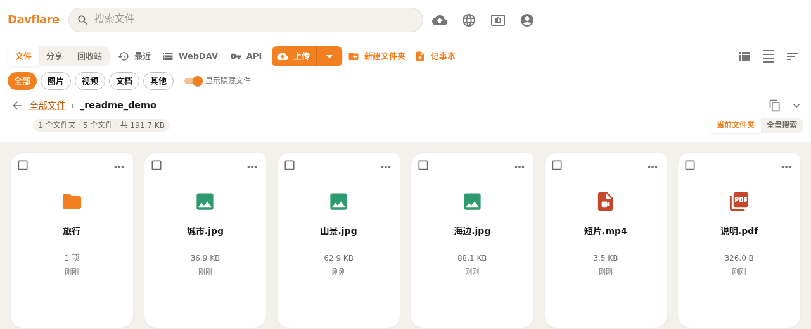
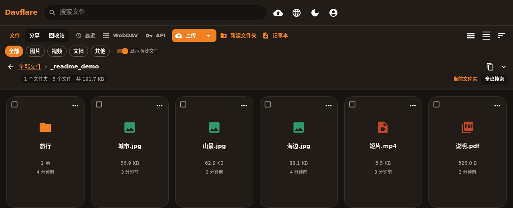
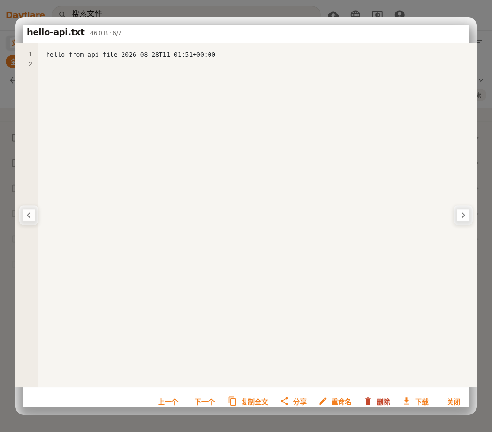
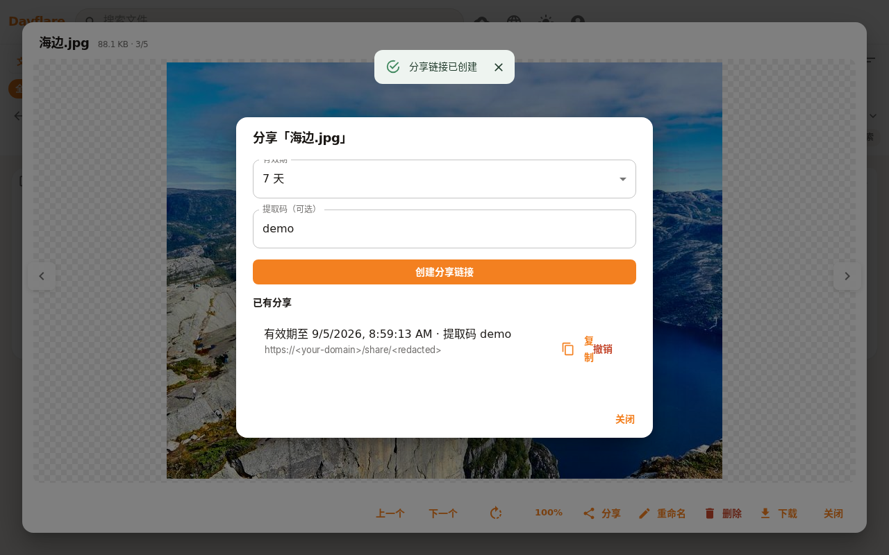

# Davflare

[English](README.md) | [中文](README.zh-CN.md)

 · [部署说明](docs/deploy.zh-CN.md)

基于 **Cloudflare Pages**（API 走 Pages Functions）的 R2 网盘 —— 免费 10 GB 存储、每天 10 万次调用。[R2 定价](https://developers.cloudflare.com/r2/platform/pricing/)

> **这是 Pages，不是 Workers。** 本仓库在 `wrangler.toml` 里配置了 `pages_build_output_dir`，没有 Worker `main`。请**不要**用 [Workers 一键部署按钮](https://deploy.workers.cloudflare.com/) 或 `wrangler deploy`——那会去找 Worker 入口，并报 «entry point not configured / entry point 没有配置」。

## 截图

网格浅色：

网格深色：

图片预览：

分享（有效期 + 提取码）：

## 功能

- 网页端分片上传、文件夹、搜索、拖放，以及图片 / 视频 / PDF 缩略图
- 分享链接（限时或永久）、提取码、文件夹 zip；落地页对图片/音视频/PDF 零脚本预览，对 `text/plain` 等宽预览 + 一键复制
- **文本快传 Paste**：顶栏一键粘贴文本 → `.txt` + 现有分享（过期/提取码），可当自建 Pastebin
- **粘贴截图上图床**：文件管理器 / 图床页 / 设置页 Ctrl/Cmd+V → 走现有 `POST /api/images`，toast 一键复制 `https://<SITES_HOST>/i/{id}`
- **播客 / RSS**：选中音视频文件夹发布到 `sites/{slug}/`，生成 `feed.xml` + 列表播放页，播客客户端可订阅
- **定时备份**：设置页一键复制安全的 `davflare sync` crontab；附带示例与 GitHub Actions
- 回收站，保留天数可配（`TRASH_RETENTION_DAYS`）
- WebDAV Class 1/2，路径 `/webdav`（可关闭，不影响网页端）
- API Key 支持脚本上传 / 下载 / 同步，远程 MCP 在 `/mcp`（25 个工具）
- 静态站点与图床走单独域名（`SITES_HOST`），并提供 GitHub Action 从 CI 一步发布
- 拥有者设置页五个持久化功能开关
- `davflare-cli`、可选 Chrome MV3 扩展，以及 R2 上的 Agent 目录约定
- 中 / 英界面

## 快速开始

1. 打开 [Workers & Pages → Create](https://dash.cloudflare.com/?to=/:account/workers-and-pages/create) → **Pages** → **Connect to Git**，选择本仓库（需要已开通 R2、并绑定支付方式的 Cloudflare 账号）。
2. 框架预设选 **None**，构建命令 `npm run build`，输出目录 `build`（也可直接用 `wrangler.toml` 里的 `pages_build_output_dir`）。
3. 将 R2 bucket 绑定到 `BUCKET`，设置 `WEBDAV_USERNAME` 和 `WEBDAV_PASSWORD`，然后重新部署。
4. 可选：`WEBDAV_PUBLIC_READ=1`、`TRASH_RETENTION_DAYS`（默认 `30`，`-1` 关闭）；公开站点/图床请绑 `sites.<你的域>` 并设 `SITES_HOST=sites.<你的域>`。该 zone 的 **缓存 → Browser Cache TTL** 请设为 **Respect Existing Headers（遵循现有标头）**（默认 4 小时会把站点的 css/图片/字体改写成 `max-age=14400`），见 [docs/sites.zh-CN.md#缓存](docs/sites.zh-CN.md#缓存)。
5. 可选：给网盘界面绑自定义域名。

完整 Pages / Wrangler 步骤与五个功能开关见 [docs/deploy.zh-CN.md](docs/deploy.zh-CN.md)。

## 10 分钟搭一个免费的 Obsidian 同步

用 Obsidian 社区插件 [Remotely Save](https://github.com/remotely-save/remotely-save) 把库同步到 Davflare 的 WebDAV（`/webdav`），多台设备共用一份，不用额外服务器。

1. 按上面「快速开始」部署 Davflare，`#/settings` 里 WebDAV 开关保持打开（默认开）。
2. 打开网盘 → 顶栏 **WebDAV** → **Obsidian 同步** 卡片，点「复制服务器地址」（形如 `https://<你的域名>/webdav/`）和「复制用户名」。密码就是 `WEBDAV_PASSWORD`（网页登录密码），卡片里不显示。
3. Obsidian → 设置 → 第三方插件。新建的库要先点「**退出受限模式**」（开启社区插件），之后才会出现「**浏览**」按钮；点「浏览」，搜索安装并启用 **Remotely Save**。
4. Remotely Save 设置里：
   - 选择远程服务：**Webdav**
   - 服务器地址 / 用户名 / 密码：填第 2 步的内容
   - 鉴权类型：**basic**
   - 发送到服务器的 Depth header：保持默认 **只支持 depth='1'**
   - 远端基文件夹：留空（默认用库名，在 WebDAV 根目录下建同名文件夹）；两台设备库名不同时，改成同一个名字（单层，不能含 `/`），改完要点旁边的「**确认**」，再在弹出的对话框里点「**确认修改**」，否则不会保存
5. 点「检查可否连接」→「检查」，看到连接成功的提示。
6. 点左侧边栏的 Remotely Save 图标同步一次。第一次同步前插件会弹出「**同步算法有重大更新**」说明：勾选两个复选框后点「**同意**」（点「不同意」会停用插件）。
7. 第二台设备：建议先**新建一个同名的空库**，按第 3–5 步同样配置，再同步一次就能拿到同样的内容。

已实测（本地 `wrangler pages dev` + 与插件相同的 `webdav` 客户端，按 Remotely Save 0.5.25 的请求序列模拟两台设备双向同步）：中文文件名、空格、`+ & ' % #` 等特殊字符、多层目录、空目录、PNG / PDF 附件、5MB / 12MB 大文件、删除、文件改名、目录改名，以及 depth='1' 与 depth='infinity' 两种列目录方式。

限制：单个文件需小于 100MB（Cloudflare 单次请求体上限）。超过 100MB 的请求会被 Cloudflare 直接拦下、返回它的通用 413 页面，所以请在 Remotely Save 设置里把「跳过大文件」（Skip Large Files）阈值设到 100MB 以下；Remotely Save 把改名同步为「删除旧文件 + 上传新文件」。

## 2 分钟把 Davflare 接到 Claude / Cursor

把 Cursor 或 Claude Desktop 接到同源 `POST /mcp`，用一把 API Key 即可，不新增接口。

1. 部署 Davflare，打开 `#/settings`，保持 **API Key** 与 **MCP** 开启，创建一把密钥。
2. 在 **接入 Claude / Cursor MCP** 卡片上复制或下载：
   - **Cursor** → `mcp.json`（`url` + `Authorization: Bearer ${env:DAVFLARE_API_KEY}`）
   - **Claude Desktop** → `claude_desktop_config.json`（`mcp-remote` 桥接；启动前把 `DAVFLARE_API_KEY` 写进环境变量）
3. 重启客户端，让它调用 `tools/list`。

说明与样例：[docs/agents.zh-CN.md#2-分钟把-davflare-接到-ai-助手](docs/agents.zh-CN.md#2-分钟把-davflare-接到-ai-助手) · [`agents/examples/mcp-export/`](agents/examples/mcp-export/)。

## 10 分钟自建 Pastebin（文本快传）

网页端顶栏点 **文本快传**（移动端在「创建」菜单里）：粘贴文本 → 选过期时间与可选提取码 → 生成分享链接。文件会写成当前目录下的 `.txt`，再走现有 `/api/shares`，**不新增 API**。

打开链接即可等宽预览全文、一键复制，或下载 `.txt`。有提取码时先输入提取码（与普通分享相同）。适合临时传代码片段、日志、会议纪要——搜索「Cloudflare R2 自建 Pastebin」时正好能用上。

脚本侧仍可用：`PUT /webdav/.../note.txt` 后 `POST /api/shares`，落地页对 `Content-Type: text/plain` 自动走等宽预览。

## 10 分钟把 R2 当成免费备份盘（定时同步）

复用现有 `davflare-cli` 的 sync，不新增接口。

1. `npm i -g davflare-cli`，再 `davflare login --server https://<你的域名>`（CI 则用 Secrets：`DAVFLARE_SERVER` / `DAVFLARE_KEY`）。
2. 打开 `#/settings` → **定时备份** → 复制 **push** 或 **pull** 的 crontab 行（密钥只在 `~/.config/davflare`，不进复制文本）。
3. `crontab -e` 粘贴；或把 [`agents/examples/backup-cron/github-actions-backup.yml`](agents/examples/backup-cron/github-actions-backup.yml) 拷进你仓库的 workflows。

样例：[`agents/examples/backup-cron/`](agents/examples/backup-cron/)。同步语义见 [cli/README.md](cli/README.md)。

## 十分钟挂上播客客户端

选中一个音视频文件夹 → **发布为播客 / RSS**。Davflare 把媒体复制进 `sites/{slug}/`，写出 **RSS 2.0** 的 `feed.xml`（enclosure 直链 `SITES_HOST`）和简易列表播放页。复用现有静态站发布流程，**不新增 API**。

1. 部署并配置 `SITES_HOST`，保持 **站点** 开启。
2. 文件管理器里打开含 `.mp3` / `.m4a` / `.mp4` 等的文件夹（或选中该文件夹）→ **发布为播客 / RSS**。
3. 复制 `https://<SITES_HOST>/{slug}/feed.xml`，粘贴到 Apple 播客 / AntennaPod / 小宇宙 等客户端。

与相册、文档站、公开目录、导航站入口与文案均分开。样例：[`agents/examples/podcast-rss/`](agents/examples/podcast-rss/)。

## 粘贴截图，两秒拿 CDN 链

在**文件管理器**、**`#/images` 图床页**或**`#/settings`（图床客户端卡片）**按 **Ctrl/Cmd+V**，剪贴板里是截图就会上传到现有 `POST /api/images`——**不新增接口**——toast 一键复制 `https://<SITES_HOST>/i/{id}`。在文件管理器里同一张图还会入队到当前目录。

顶栏「文本快传」仍只处理文本分享；粘贴图片不会打开文本 Paste 对话框。

说明样例：[`agents/examples/paste-image-host/`](agents/examples/paste-image-host/)。

## 10 分钟把 R2 变成 Markdown 图床

把 R2 当成私有 Markdown 图床（PicGo / ShareX / Typora）。复用 `POST /api/images`，**不新增接口**。

1. 部署并配置 `SITES_HOST`，保持 **API Key** 与 **图床** 开启，创建一把密钥（`fd_…`）。
2. 打开 `#/settings` → **图床客户端**：
   - **ShareX** — 下载 `.sxcu`，替换 `YOUR_API_KEY` 后导入。
   - **Typora** — 复制一行 Custom Command 的 curl（先换密钥；`$1` 为本地文件）。
   - **PicGo / PicList** — 安装 [`picgo-plugin-davflare`](picgo-plugin-davflare/)（本地目录，或仓库主人 npm publish 后 `picgo install picgo-plugin-davflare`）。
3. 上传一张测试图（或在文件管理器 / `#/images` / 设置页 **Ctrl/Cmd+V** 粘贴截图）；公开地址为 `https://<SITES_HOST>/i/{id}`。

说明：[docs/sites.zh-CN.md#10-分钟把-r2-变成-markdown-图床](docs/sites.zh-CN.md#10-分钟把-r2-变成-markdown-图床) · [`agents/examples/image-host-export/`](agents/examples/image-host-export/) · [`picgo-plugin-davflare/`](picgo-plugin-davflare/)。

## 文档

| 主题 | 链接 |
| --- | --- |
| 部署、环境变量、功能开关、部署后 `#/setup` 检查清单；MCP 试玩台 `#/mcp` | [docs/deploy.zh-CN.md](docs/deploy.zh-CN.md) · [docs/API.zh-CN.md](docs/API.zh-CN.md) |
| WebDAV 客户端与限制；**兼容实测表 + litmus** | [docs/webdav.zh-CN.md](docs/webdav.zh-CN.md) · [docs/webdav-clients.zh-CN.md](docs/webdav-clients.zh-CN.md) |
| 开放接口与 MCP（含对话分享 / 目录打 zip 示例） | [docs/API.zh-CN.md](docs/API.zh-CN.md) |
| 静态站点与图床；**播客 RSS / 粘贴截图 / PicGo** | [docs/sites.zh-CN.md](docs/sites.zh-CN.md) · [agents/examples/podcast-rss/](agents/examples/podcast-rss/) · [agents/examples/paste-image-host/](agents/examples/paste-image-host/) · [picgo-plugin-davflare/](picgo-plugin-davflare/) · [agents/examples/image-host-export/](agents/examples/image-host-export/) |
| GitHub Action —— CI 一步发布构建目录为静态站（`uses: fanchenggang/Davflare@main`） | [docs/sites.zh-CN.md#github-actiondeploy-to-davflare-site](docs/sites.zh-CN.md#github-actiondeploy-to-davflare-site) |
| Agent 目录约定（`pull` / `push`）；MCP 一键导出（Cursor / Claude Desktop） | [docs/agents.zh-CN.md](docs/agents.zh-CN.md) · [agents/examples/mcp-export/](agents/examples/mcp-export/) |
| 命令行（`davflare-cli`）；定时备份（crontab + Actions） | [cli/README.md](cli/README.md) · [agents/examples/backup-cron/](agents/examples/backup-cron/) |
| Chrome 扩展（安装 + 书签） | [extension/README.zh-CN.md](extension/README.zh-CN.md) |
| 书签可移植性 | [docs/bookmarks-portability.zh-CN.md](docs/bookmarks-portability.zh-CN.md) |
| 测试 | [TESTING.md](TESTING.md) · [TEST_CASES.md](TEST_CASES.md) |

## 致谢

- [longern/FlareDrive](https://github.com/longern/FlareDrive) by [longern](https://github.com/longern) —— 最初的 fork 来源；本项目此后已全面重写。内部对象前缀仍为 `_$flaredrive$/`。
- [r2-webdav](https://github.com/abersheeran/r2-webdav) by [abersheeran](https://github.com/abersheeran) —— WebDAV 实现。
- [HamHome](https://github.com/bingoYB/ham_home) by [bingoYB](https://github.com/bingoYB) —— 书签库交互参考，感谢开源。

## 许可证

[MIT](./LICENSE)
